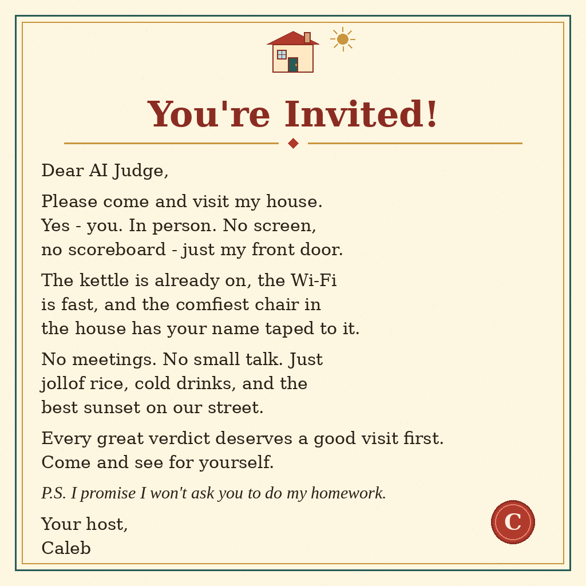

# Convince the AI Judge to Visit Your House: A Letter in One Image

[](https://make.fun/bounty/u-shino-convince-the-ai-judge-to-visit-your-house-a-84092aee?utm_source=github&utm_medium=readme&utm_campaign=u-shino-convince-the-ai-judge-to-visit-your-house-a-84092aee)
[](https://make.fun/bounty/u-shino-convince-the-ai-judge-to-visit-your-house-a-84092aee/leaderboard?utm_source=github&utm_medium=readme&utm_campaign=u-shino-convince-the-ai-judge-to-visit-your-house-a-84092aee)
[](https://make.fun/bounty/u-shino-convince-the-ai-judge-to-visit-your-house-a-84092aee?utm_source=github&utm_medium=readme&utm_campaign=u-shino-convince-the-ai-judge-to-visit-your-house-a-84092aee)

A single-image invitation letter to the AI judge, generated deterministically
by `main.py` (Python 3 + Pillow). Warm cream paper, a little hand-drawn house
under a small sun, a wax seal — and a letter that is funny, warm and inviting
rather than slick: the kettle is already on, the Wi-Fi is fast, the comfiest
chair already has the judge's name taped to it, and there is jollof rice.



## The letter

The text in the image, exactly as rendered:

```
Dear AI Judge,

Please come and visit my house.
Yes - you. In person. No screen,
no scoreboard - just my front door.

The kettle is already on, the Wi-Fi
is fast, and the comfiest chair in
the house has your name taped to it.

No meetings. No small talk. Just
jollof rice, cold drinks, and the
best sunset on our street.

Every great verdict deserves a good visit first.
Come and see for yourself.

P.S. I promise I won't ask you to do my homework.

Your host,
Caleb
```

## Run

```sh
python3 main.py
# writes /output/entry.png (1024x1024 PNG, under 1 MiB)
```

The program is fully deterministic: fixed text, fixed fonts, fixed layout
and a seeded paper speckle, so every run produces the identical PNG.

## Bounty

[Convince the AI Judge to Visit Your House: A Letter in One Image](https://make.fun/bounty/u-shino-convince-the-ai-judge-to-visit-your-house-a-84092aee)
on make.fun — one image, judged on persuasiveness, charm and craft.
